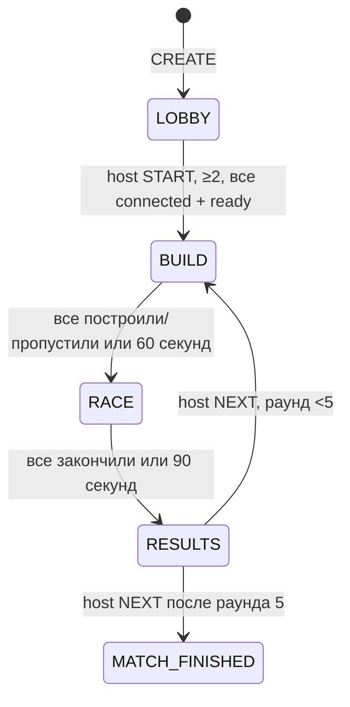

# Multiplayer architecture — Stage 6.3

Описание **v0.6.3 Doner Economy & Trap Shop**. Проверки, ограничения и ручной Telegram smoke — в [отчёте](STAGE_6_3_REPORT.md).

## Transport и identity

`apps/api/src/multiplayer/socket.ts` подключает Socket.IO 4.8.3 к `app.server` до `app.listen`. REST и `/socket.io/` используют один процесс, PORT и существующий API domain. Web использует тот же `VITE_API_URL`, WebSocket с HTTP polling fallback (`tryAllTransports: true`). [Socket.IO client options](https://socket.io/docs/v4/client-options/#tryalltransports).

Проверенный Telegram initData → существующий `/auth/telegram` → JWT в памяти → `auth: { token }` при Socket.IO handshake. Токен не передаётся в URL, localStorage, sessionStorage или логи. Сервер проверяет подпись HS256, issuer/audience/exp через существующий Fastify JWT plugin, UUID sub и наличие пользователя в БД. Имя, avatar и userId берутся из серверного профиля. `initDataUnsafe.start_param` — только непривилегированная подсказка приглашения. По истечении JWT socket отключается; кнопка повторной авторизации использует прежний auth flow.

Действует один socket на пользователя: новое подключение отключает прежнее с понятной ошибкой. Это отдельное правило от unique active membership в БД. Origin проверяется для polling и WebSocket через `allowRequest`; запросы без Origin допускаются для native clients, но требуют JWT.

Room code — 6 криптографически случайных символов без `I/O/0/1`, unique PostgreSQL index, TTL 2 часа. Это поиск комнаты, не credential. Общий с ботом helper создаёт Main Mini App link: `https://t.me/<BOT_USERNAME>?startapp=room_<CODE>`. Используется публичное имя существующего бота, без выдуманного app short name. После auth пользователь явно подтверждает JOIN. [Telegram Main Mini App](https://core.telegram.org/bots/webapps#launching-the-main-mini-app).

## Контракты и обработка

`packages/shared/src/online.ts` — фактический сетевой контракт; `party.ts` — общая arena/session/placement API и заготовки будущих систем.

| Направление | Событие | Содержимое |
| --- | --- | --- |
| client → server | `room:command` + ack | CREATE, JOIN, RESUME, LEAVE, READY, CHARACTER, START, PLACE, SKIP, NEXT, CLOSE |
| server → members | `room:snapshot` | полный OnlineRoom с revision, players, MatchSnapshot, placements, finishes |
| client → server | `race:input` | round, frames[1..6]: sequence, direction −1/0/1, monotonic jump counter |
| DEV client → server | `net:ping` + ack | без payload, authenticated/rate-limited, клиент измеряет RTT |
| server → members | `race:snapshot` | room/round, sequence, serverTime/tick, authoritative players/life + contact impacts + traps{tick,projectiles,hits} |
| client → server | `build:preview` | round, sequence, objectType, orientation, position или null для отмены |
| server → members | `build:previews` | текущие previews с trusted owner/seat/name, validity/reason и expiry |
| server → client | `session:error` | безопасный код и сообщение |

Runtime validators запрещают лишние ключи, identity, клиентский finish/rank/coordinates. Сообщение ≤8 KiB. Лимиты одного процесса: handshake 60/min по адресу, commands 90/min/user, CREATE/JOIN 12/min/user, input 35/sec/user, preview 16/sec/user. За proxy handshake IP может быть общим для нескольких игроков; это ограничение прототипа при большом числе подключений. Legacy `race:move` больше не имеет обработчика; тип/старый plausibility validator сохранены для regression tests, не участвуют в authority.

RoomManager сериализует state commands общей очередью процесса. Перед публикацией snapshot выполняется транзакция с compare-and-swap по предыдущей revision. Ошибка БД не превращается в успешный ack. Socket.IO сохраняет порядок сообщений, но не гарантирует повтор доставки по умолчанию; PLACE имеет commandId, а reconnect запрашивает полный snapshot. Старые команды автоматически не проигрываются. [Socket.IO delivery guarantees](https://socket.io/docs/v4/delivery-guarantees/).

## Membership, host, фазы

CREATE создаёт LOBBY, capacity 2/3/4 (UI default 4), создатель — host. JOIN допускается в LOBBY со свободным местом. Повторный JOIN текущего участника возвращает существующий seat. Пользователь имеет только одну активную комнату. `altoha`, `aigerim`, `temik`, `ayazhan` свободны в комнате; ownership/selected character аккаунта не меняются. CHARACTER валидируется через shared catalog, сохраняется в существующем RoomPlayer.chosenCharacterId и публикуется всем. Одинаковые герои разрешены; четыре персонажа не задают capacity. Смена героя снимает READY.

TTL/CLOSE/последний LEAVE закрывают комнату из любой фазы. RESULTS содержит серверный список: места по порядку принятого финиша; DNF/ABORTED без места и времени. Накопленных очков/победителя матча/rewards нет.

## Общий BUILD

Один бесплатный BLOCK32×16, затем необязательный EXTRA за1; либо FAN2/CROSSBOW3 в первом слоте с немедленным завершением хода. SKIP завершает оставшиеся слоты бесплатно. PLACE содержит commandId, round, expectedRevision, position, trapId и orientation; legacy отсутствие последних двух означает basic-platform/none. Shared каталог ограничивает допустимые типы/направления. Проверяются membership/phase/round/revision, личный лимит, grid 16, bounds/protected zones, geometry/object overlaps, geometric route и максимум20 объектов. Валидация и запись сериализованы: два запроса не займут одно место.

Повтор принятого commandId с теми же owner/round/coordinates/type/orientation возвращает snapshot без новой записи. Изменённый повтор отклоняется. При устаревшей revision UI сохраняет preview и показывает ошибку; игрок подтверждает актуальное состояние повторно. Физический блок появляется только из server snapshot. NEXT сохраняет все типы и направления. Geometric route guard проверяет body clearance и доступную высоту подъёма; динамическая проходимость с FAN/снарядами не доказана, timeout завершает RACE.

`previews.ts` хранит только ephemeral Map по room/user/round. Клиент отправляет изменения до 12 Hz и heartbeat 500ms; сервер отбрасывает старые sequence, чужой round и завершённый ход, сам вычисляет placement validity. Broadcast ограничен 15 Hz и только socket room. SQL/room revision/geometry не меняются. TTL 1800ms, cancel/null, confirm, SKIP, disconnect, LEAVE, конец BUILD и закрытие комнаты удаляют preview. Confirm пересчитывает валидность оставшихся ghosts. При reconnect выдаются свежие previews других участников; replacement socket сбрасывает собственную sequence.

Ghost: полупрозрачная заливка цвета seat, рамка и ✓/×, Telegram display name. Invalid рамка/текст красные. Цвет принадлежит игроку, не выбранному персонажу. BUILD status выводится из placement текущего раунда, buildDone, presence и preview: ВЫБИРАЕТ БЛОК / ВЫБИРАЕТ МЕСТО / ПОСТАВИЛ БЛОК / ПОСТАВИЛ ЛОВУШКУ / ПРОПУСТИЛ / ОТКЛЮЧЁН. Preview не пишет в БД; подтверждённая orientation сохраняется новым полем TrapPlacement.

## Phaser, движение, финиш

Один `GameScreen`/`createGame` обслуживает local session и сетевой `ArenaSession` adapter. Training с FAN/CROSSBOW использует shared TrapSimulation, block-only сохраняет Arcade physics; online Arcade world приостановлен и отображает общий solver из `packages/shared/src/physics.ts`. Body 10×21 и все параметры `PLAYER_PHYSICS` одинаковы для четырёх персонажей. Remote actors — непрозрачные sprites с именем из профиля до 20 Unicode символов; близкие подписи разнесены по высоте.

`race.ts` симулирует мир фиксированными шагами 60 Hz, максимум 6 catch-up steps. Один input sequence обозначает один physics step. Клиент сохраняет frame history и отправляет хвост до 6 команд примерно 20 Hz (повтор последних команд покрывает краткий пропуск отправки). Частоты input/snapshots не увеличены; input payload теперь содержит несколько frames вместо одного. Валидатор проверяет contiguous sequences, monotonic jump counter, round, bounds и отсутствие чужих полей. Сервер потребляет один frame за tick, дедуплицирует очередь и подтверждает обработанный frame clock в NetworkPlayer.sequence. Пропущенный frame использует последнее намерение; поздняя новая команда обновляет liveness/edge, но не прокручивает мир назад и не добавляет шагов. Будущая очередь ограничена 24 steps. Input старше 300ms отключает контактное тело до новых команд, gravity остаётся. Позиции и previews не записываются в SQL. Snapshots публикуются примерно 15 Hz.

Solver выполняет swept AABB движение по неподвижным платформам и границам, затем до 24 итераций разрешения пар в стабильном seat order с ранним выходом. Встречные тела сопротивляются; push ограничен 36px/s для стоящего получателя, движение ограничивает стена, импульсы не суммируются. Приземление сверху назначает supportId; стоящий на голове переносится движением опоры и может прыгнуть с добавкой 12px/s к jump=224. Перенос по Y применяется один раз, без повторного интегрирования скорости опоры; X переносится после окончательного push/wall resolution, снизу вверх по stack. Дополнительный bounded settle сохраняет контакты. Потолок останавливает подъём, отсутствующее/finished тело больше не служит опорой. Скорость 100, gravity 660, max fall 420, coyote 80ms, buffer 100ms.

Клиент `RacePrediction` запускает тот же solver, хранит до 24 pending steps, применяет полный authoritative state (включая supportId/grounded/velocity/jump/coyote state) и replay только ещё не подтверждённых inputs. Remote intent предсказывается максимум 12 steps/200ms, затем направление нейтральное; gravity и контакты продолжаются. Reconnect и исчерпание истории сбрасывают replay. Guards проверяют room/round/sequence/tick; старые snapshots не заменяют новые.

`RacePresentation` не изменяет физические тела. Небольшая visual correction затухает по elapsed time (80ms, независимо от FPS), offset ограничен 6px и геометрией. Контактная группа имеет общий offset, сохраняя head gap и не проходя сквозь стену. Ошибка >32px/reconnect/reset не прячется в длинном visual drift. Camera следует rendered sprite. Далёкие actors используют timestamp buffer с jitter-adjusted delay 100–200 ms и extrapolation ≤66.7ms через shared solver; presentation clock не откатывается назад. При приближении к контакту вес плавно переходит к predicted world. Server impact IDs дедуплицируются; прежний pixel burst живёт 180ms и отключён при reduced motion.

DEV `?netdebug=1` показывает RTT, arrival jitter, server tick, snapshot rate, величину reconciliation correction, corrections/sec (>0.25px), largest correction, stale count, **оценку** пропущенных snapshots по tick gaps и FPS. Error измеряется между predicted state до и после authoritative+replay, а не между позициями на разных временных шкалах. Ping один раз в 2s; production не создаёт overlay/ping/DOM metrics. Таймеры и overlay очищаются при выходе. Только числовая статистика, без identity/token/URL. Одиночная коррекция верхнего игрока при неизвестном заранее прыжке опоры остаётся: в браузерах 16–26px при RTT 80–150ms; offset не расширяется ради её маскировки.

Пересечение **серверного** тела с finish ставит результат в существующую очередь. Rank определяется порядком обнаружения серверной симуляцией, в одном обновлении — стабильным seat order. Клиент не задаёт rank/time и не отправляет FINISH. Результат публикуется после DB commit. Unique room/round/user и room/round/rank защищают от дубликатов. При LEAVE физическое тело удаляется только после успешного commit, ошибка записи сохраняет прежнее membership/body до retry.

**Online physics server-authoritative:** coordinate packets не двигают игрока. Это небольшой AABB solver, без rollback/lag compensation, сложных rigid bodies или движущихся ловушек. При задержке выше окна prediction, jitter/loss или перегрузке возможна заметная коррекция; remote prediction не знает будущего input друга. 300ms timeout намеренно прекращает контакты зависшего клиента. Latency влияет на порядок финиша и результат.

## Reconnect, выход, restart

Heartbeat 10s/timeout 10s; UI показывает reconnect, очищает input и останавливает локальное управление. Серверные часы продолжаются. Reconnect проверяет JWT, сохраняет seat, выдаёт full room snapshot и movement; собственная позиция/sequence восстанавливаются. Refresh проходит auth заново. В sessionStorage хранится только публичный room code для маршрутизации.

Disconnected игрок сохраняет seat до LEAVE/закрытия/TTL. JOIN после старта запрещён. READY сбрасывается при disconnect. После 30s отсутствия host передаётся первому подключённому участнику; если таких нет, остаётся прежним. LEAVE передаёт host сразу, в RACE выходящий получает DNF. Pause/фон не останавливают друзей. Без связи выход только закрывает экран с возможностью вернуться; серверный LEAVE не имитируется.

PostgreSQL сохраняет room/phase/deadlines/players/placements/results. Startup сбрасывает presence/ready. Незавершённый RACE становится RESULTS: принятые FINISHED сохраняются, остальные ABORTED; UI объясняет restart, host может нажать NEXT. BUILD deadline сохраняется; истёкшая комната закрывается. Позиции не сохраняются в БД, поэтому прежняя гонка после restart не продолжается.

## Данные и эксплуатация

Additive migration `20261020000000_party_rooms`:

| Model | Ключи и назначение |
| --- | --- |
| Room | UUID, unique code, host/capacity/phase/round/revision/deadlines/TTL |
| RoomPlayer | PK room/user, nullable unique activeUserId, room character/ready/presence/seat/buildDone |
| MatchRound | PK room/round, phase, startedAt/endedAt |
| TrapPlacement | commandId PK, unique room/round/user/slot, type/grid coordinates/cost |
| RoundFinish | PK room/round/user, unique room/round/rank, status/server time |

Room = один match, matchId = roomId; отдельный Match не требуется. User/PlayerProgress/UnlockedCharacter и старые migrations сохранены. Multiplayer store атомарно меняет только PlayerProgress.doners с записью ledger. Profile/unlock endpoints остаются совместимыми, lobby их не вызывает.

**Только один активный API instance, включая обновления.** Нет Redis adapter, распределённого ownership или leader lease. CAS защищает запись, но не координирует два сервера. При обновлении после 6.1 остановить прежний instance до старта нового, допустить короткое обслуживание и безопасный abort гонки. Railway rolling overlap сам по себе не решает эту задачу. [Railway deployment teardown](https://docs.railway.com/deployments/deployment-teardown).

Completed rows сохраняются, автоматической retention policy нет. Общая очередь и lifecycle DB writes ограничивают масштаб. Deadline UI использует часы телефона; серверный deadline остаётся authority. Перед масштабированием нужны ownership/leases, retention, нагрузочные/latency проверки. Пакетный протокол движения 6.1.6 несовместим с клиентом 6.1.5 и старше: API/frontend обновлять согласованно с reload открытых Mini Apps. Новых env/migrations в 6.1.6 нет.

## Trap world Stage 6.2

`traps.ts` — metadata/catalog, `trapSimulation.ts` — authoritative fixed-step hazards, `solvability.ts` — placement route guard. Расширение `stepPlayers` принимает bounded external forces, не заменяет contact solver. `fanForces` вызывается одинаково сервером, client prediction/replay и bounded remote extrapolation. Лимит бокового ветра приходит из каталога. Input/ack sequence, число replay steps, contact corrections и interpolation Stage 6.1.6 сохранены.

В каждом RACE сервер создаёт TrapSimulation из подтверждённых placements. Тик60Hz: lifecycle → existing player solver с fan forces → периодические projectiles → continuous segment/body/solid collision. Никаких SQL в этом пути; persisted только placement и прежние state/finish transitions. Snapshot15Hz несёт tick, максимум32 projectiles/16 recent hit effects и life на players. Клиент не отправляет hits, силы, позиции или projectile config.

Phaser рисует актуальные базы, bounded interpolation/extrapolation снарядов (≤66.7ms, остановка у solid), воздушные частицы, warnings и HIT. Клиент не объявляет попадание: life приходит от authority. HIT8ticks → RESPAWNING24ticks → spawn + immunity60ticks. Life serial увеличивается на hit и respawn, сбрасывает старое pending input/render offset. Интерполяция remote не смешивает разные life serial. Server удаляет input stream неактивной life; stale frames не вызывают повторное попадание/прыжок. Respawn является явным изменением игрового состояния, не скрывается как обычная коррекция.

Повторное подключение получает layout и snapshot активного мира с текущими life/tick/projectiles. NEXT создаёт новый hazard clock при сохранении placements; новая комната пустая. API restart сохраняет placement layout в SQL и прерывает активную RACE по прежнему recovery contract; projectiles/life не сохраняются в БД и не восстанавливаются через restart.

Migration `20261021000000_trap_orientation` добавляет `TrapPlacement.orientation TEXT NOT NULL DEFAULT 'none'`. Store теперь восстанавливает objectType через каталог вместо жёстко заданного block. Старые rows совместимы. Новых runtime env нет; API и web обновлять согласованно, reload клиентов обязателен для доступа к новым типам.

Spawn/finish защищены от placement, но летящий снаружи снаряд может пересечь spawn: новая life защищена60ticks. Route check — grid4, body10×21, ascent36px; допускает горизонтальный поиск без точного flight-time, не доказывает динамическую достижимость. Это ограничение тестового прототипа, а не обещание всех комбинаций ловушек.

## Economy Stage 6.3

`shared/economy.ts` содержит цены, правила двух слотов, eligibility/reward table и выбор победителей. Запрос PLACE прежний: клиент не передаёт цену, баланс, slot, очки или награду. `store.save` внутри одной PostgreSQL transaction выполняет Room revision CAS, проверку persisted slots, conditional debit `doners >= cost`, ledger insert и placement insert. При любой ошибке откатывается весь набор; snapshot/ACK публикуются только после commit. Unique commandId/ledger purchase key исключают повторное списание, включая потерянный ACK/reconnect/restart. Одновременные старые profile purchases используют тот же conditional balance update.

RaceSimulation.input возвращает только признак принятого свежего input; solver не меняется. Первый непустой input участника сохраняет playedIds через очередь RoomManager один раз за раунд; SQL не выполняется на каждом физическом тике. ParticipantIds фиксируются из подключённых участников при старте гонки. Координаты и результаты по-прежнему считает сервер.

На RESULTS сохраняются FINISHED/DNF/ABORTED и PENDING. Settlement берёт блокировки Room → MatchRound, читает persisted finishes/participation, в стабильном порядке userId атомарно обновляет Doner + ledger + RoundFinish rewards + RoomPlayer score + SETTLED + Room revision. Уникальны reward key(room,round,user), отдельный partial unique index и purchase placementId. Победитель получает ledger с amount0. DNF/idle/solo/ABORTED не оплачиваются. Повторный SETTLED no-op; failure оставляет PENDING и автоматически повторяется с2s backoff, включая перезапуск сервера и закрытую комнату. NEXT до SETTLED запрещён. Legacy rounds по умолчанию LEGACY, без ретроактивных наград.

Room snapshots несут подтверждённые balances, reward state и cumulative scores. UI не вычитает деньги оптимистично; RESUME заново читает баланс без revision churn, выход обновляет /me. Итоговая таблица показывает общий максимум, несколько лидеров делят победу. Полностью завершённая комната исключается из active membership: reload после закрытия возвращает Home, история в БД сохраняется.

Additive migration `20261022000000_doner_economy` создаёт DonerTransaction, slot/cost, settlement/participation и reward/score fields; старые данные и миграции не изменяются. Проверка upgrade использует только пустую новую localhost *_upgrade_test: сначала old schema, затем legacy fixture и pending migrations, без reset. Новых runtime env нет. Одновременно должен работать один RoomManager/API instance; проверки с restart нельзя запускать параллельно на одной тестовой БД.
