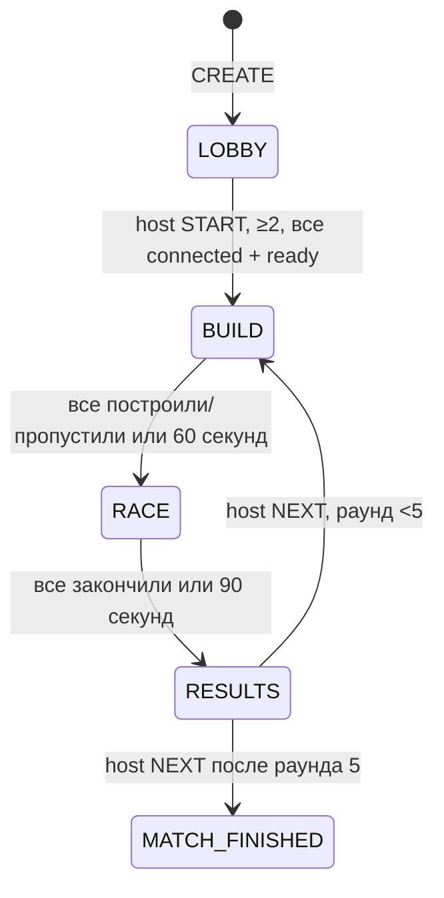

# Multiplayer architecture — Stage 6.1

Описание реализованного **v0.6.1 Real Multiplayer Prototype**. Проверки и оставшийся ручной Telegram smoke — в [отчёте](STAGE_6_1_REPORT.md).

## Transport и identity

`apps/api/src/multiplayer/socket.ts` подключает Socket.IO 4.8.3 к `app.server` до `app.listen`. REST и `/socket.io/` используют один процесс, PORT и существующий API domain. Web использует тот же `VITE_API_URL`, WebSocket с HTTP polling fallback (`tryAllTransports: true`). [Socket.IO client options](https://socket.io/docs/v4/client-options/#tryalltransports).

Проверенный Telegram initData → существующий `/auth/telegram` → JWT в памяти → `auth: { token }` при Socket.IO handshake. Токен не передаётся в URL, localStorage, sessionStorage или логи. Сервер проверяет подпись HS256, issuer/audience/exp через существующий Fastify JWT plugin, UUID sub и наличие пользователя в БД. Имя, avatar и userId берутся из серверного профиля. `initDataUnsafe.start_param` — только непривилегированная подсказка приглашения. По истечении JWT socket отключается; кнопка повторной авторизации использует прежний auth flow.

Действует один socket на пользователя: новое подключение отключает прежнее с понятной ошибкой. Это отдельное правило от unique active membership в БД. Origin проверяется для polling и WebSocket через `allowRequest`; запросы без Origin допускаются для native clients, но требуют JWT.

Room code — 6 криптографически случайных символов без `I/O/0/1`, unique PostgreSQL index, TTL 2 часа. Это поиск комнаты, не credential. Общий с ботом helper создаёт Main Mini App link: `https://t.me/<BOT_USERNAME>?startapp=room_<CODE>`. Используется публичное имя существующего бота, без выдуманного app short name. После auth пользователь явно подтверждает JOIN. [Telegram Main Mini App](https://core.telegram.org/bots/webapps#launching-the-main-mini-app).

## Контракты и обработка

`packages/shared/src/online.ts` — фактический сетевой контракт; `party.ts` — общая arena/session/placement API и заготовки будущих систем.

| Направление | Событие | Содержимое |
| --- | --- | --- |
| client → server | `room:command` + ack | CREATE, JOIN, RESUME, LEAVE, READY, CHARACTER, START, PLACE, SKIP, NEXT, CLOSE |
| server → members | `room:snapshot` | полный OnlineRoom с revision, players, MatchSnapshot, placements, finishes |
| client → server | `race:move` | round, sequence, body center x / feet y, velocityX/Y |
| server → members | `race:snapshot` | room/round, sequence, serverTime, принятые позиции |
| server → client | `race:correction` | последняя принятая позиция |
| server → client | `session:error` | безопасный код и сообщение |

Runtime validators запрещают лишние ключи, identity, клиентский finish/rank. Сообщение ≤8 KiB. Лимиты одного процесса: handshake 60/min по адресу, commands 90/min/user, CREATE/JOIN 12/min/user, движение 35/sec/user. За proxy handshake IP может быть общим для нескольких игроков; это ограничение прототипа при большом числе подключений.

RoomManager сериализует state commands общей очередью процесса. Перед публикацией snapshot выполняется транзакция с compare-and-swap по предыдущей revision. Ошибка БД не превращается в успешный ack. Socket.IO сохраняет порядок сообщений, но не гарантирует повтор доставки по умолчанию; PLACE имеет commandId, а reconnect запрашивает полный snapshot. Старые команды автоматически не проигрываются. [Socket.IO delivery guarantees](https://socket.io/docs/v4/delivery-guarantees/).

## Membership, host, фазы

CREATE создаёт LOBBY, capacity 2/3/4 (UI default 4), создатель — host. JOIN допускается в LOBBY со свободным местом. Повторный JOIN текущего участника возвращает существующий seat. Пользователь имеет только одну активную комнату. `altoha`, `aigerim`, `temik` свободны в комнате; ownership/selected character аккаунта не меняются. Смена героя снимает READY.

TTL/CLOSE/последний LEAVE закрывают комнату из любой фазы. RESULTS содержит серверный список: места по порядку принятого финиша; DNF/ABORTED без места и времени. Накопленных очков/победителя матча/rewards нет.

## Общий BUILD

Один бесплатный BASIC PLATFORM BLOCK 32×16 на участника за раунд либо SKIP. PLACE содержит commandId, round, expectedRevision, position. Проверяются membership/phase/round/revision, личный лимит, grid 16, bounds/protected zones, geometry/block overlaps и максимум 20 блоков. Валидация и запись сериализованы: два запроса не займут одно место.

Повтор принятого commandId с теми же owner/round/coordinates возвращает snapshot без новой записи. Изменённый повтор отклоняется. При устаревшей revision UI сохраняет preview и показывает ошибку; игрок подтверждает актуальное состояние повторно. Физический блок появляется только из server snapshot. NEXT сохраняет блоки. Глобальная проходимость не доказана; timeout завершает непроходимый RACE.

## Phaser, движение, финиш

Один `GameScreen`/`createGame` обслуживает local session и сетевой `ArenaSession` adapter. Geometry, movement constants, input, collisions, camera и lifecycle общие. Body 10×21 у всех; player-player collisions нет. Remote actors — непрозрачные sprites с interpolation и серверным именем до 20 Unicode символов; подписи близких игроков разнесены по высоте.

Локальная Arcade physics даёт немедленный отклик. Movement отправляется/рассылается примерно 15 Hz, volatile, без PostgreSQL записи. Сервер хранит accepted sequence/position, суммарный путь, grounded/air history. Проверяет round, порядок пакетов, bounds, скорость/перемещение, путь по серверному времени, swept body against solids, высоту/длительность прыжка. Landing + buffered jump между пакетами учитывается только рядом с достижимой реальной поверхностью.

Пересечение **принятого** тела с finish ставит результат в серверную очередь. Rank определяется порядком обработки; равные timestamps получают последовательные места. Клиент не задаёт rank/time и не отправляет FINISH. Результат публикуется после DB commit. Unique room/round/user и room/round/rank защищают от дубликатов.

**Это клиентская physics с server plausibility checks, не полная server-authoritative simulation.** Правдоподобный синтетический путь может пройти проверки. Latency влияет на место; компенсации задержки/rollback нет. Долгая задержка может вызвать коррекцию позиции. Для соревновательных наград этого недостаточно; экономика в 6.1 отсутствует.

## Reconnect, выход, restart

Heartbeat 10s/timeout 10s; UI показывает reconnect, очищает input и останавливает локальное управление. Серверные часы продолжаются. Reconnect проверяет JWT, сохраняет seat, выдаёт full room snapshot и movement; собственная позиция/sequence восстанавливаются. Refresh проходит auth заново. В sessionStorage хранится только публичный room code для маршрутизации.

Disconnected игрок сохраняет seat до LEAVE/закрытия/TTL. JOIN после старта запрещён. READY сбрасывается при disconnect. После 30s отсутствия host передаётся первому подключённому участнику; если таких нет, остаётся прежним. LEAVE передаёт host сразу, в RACE выходящий получает DNF. Pause/фон не останавливают друзей. Без связи выход только закрывает экран с возможностью вернуться; серверный LEAVE не имитируется.

PostgreSQL сохраняет room/phase/deadlines/players/placements/results. Startup сбрасывает presence/ready. Незавершённый RACE становится RESULTS: принятые FINISHED сохраняются, остальные ABORTED; UI объясняет restart, host может нажать NEXT. BUILD deadline сохраняется; истёкшая комната закрывается. Позиции не сохраняются в БД, поэтому прежняя гонка после restart не продолжается.

## Данные и эксплуатация

Additive migration `20261020000000_party_rooms`:

| Model | Ключи и назначение |
| --- | --- |
| Room | UUID, unique code, host/capacity/phase/round/revision/deadlines/TTL |
| RoomPlayer | PK room/user, nullable unique activeUserId, room character/ready/presence/seat/buildDone |
| MatchRound | PK room/round, phase, startedAt/endedAt |
| TrapPlacement | commandId PK, unique room/round/user, type/grid coordinates |
| RoundFinish | PK room/round/user, unique room/round/rank, status/server time |

Room = один match, matchId = roomId; отдельный Match не требуется. User/PlayerProgress/UnlockedCharacter и старые migrations сохранены. Multiplayer store не пишет в PlayerProgress. Profile/unlock endpoints остаются совместимыми, lobby их не вызывает.

**Только один активный API instance, включая обновления.** Нет Redis adapter, распределённого ownership или leader lease. CAS защищает запись, но не координирует два сервера. При обновлении после 6.1 остановить прежний instance до старта нового, допустить короткое обслуживание и безопасный abort гонки. Railway rolling overlap сам по себе не решает эту задачу. [Railway deployment teardown](https://docs.railway.com/deployments/deployment-teardown).

Completed rows сохраняются, автоматической retention policy нет. Общая очередь и state DB writes ограничивают масштаб. Deadline UI использует часы телефона; серверный deadline остаётся authority. Перед масштабированием нужны ownership/leases, retention, нагрузочные/latency проверки и полноценная симуляция при введении rewards.
